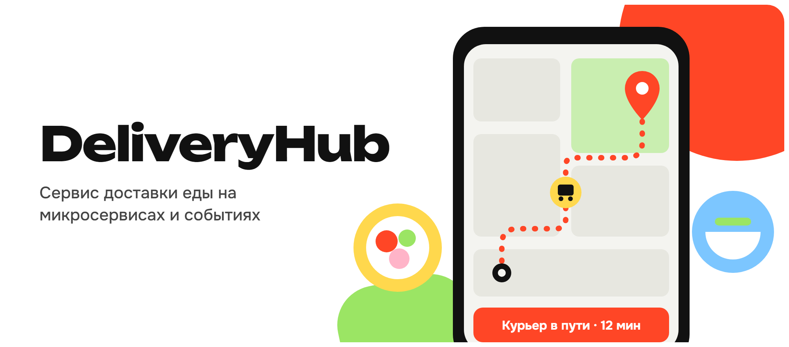
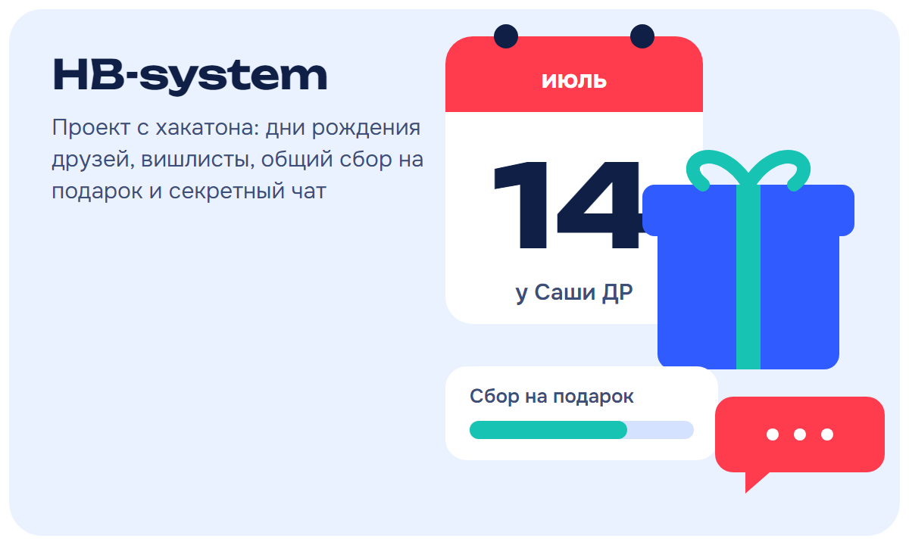
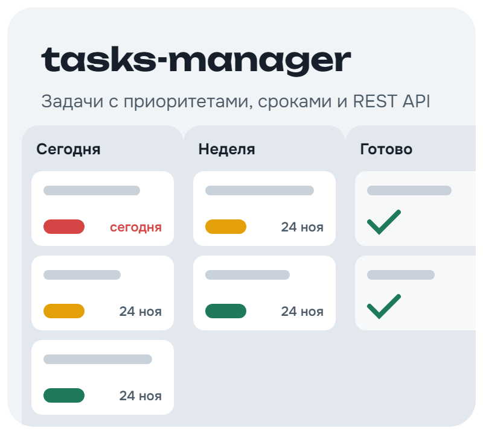
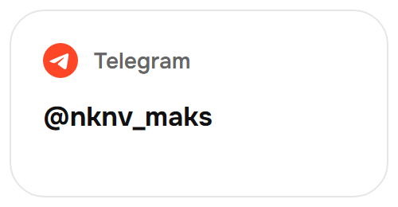
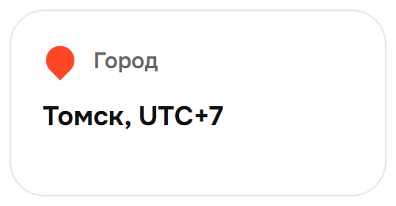

<picture><source media="(prefers-color-scheme: dark)" srcset="assets/header-dark.png"></picture>
<a href="https://github.com/nmaksimka/Delivery-Hub"><picture><source media="(prefers-color-scheme: dark)" srcset="assets/deliveryhub-dark.png"></picture></a>
<a href="https://github.com/nmaksimka/HB-system"><picture><source media="(prefers-color-scheme: dark)" srcset="assets/hb-system-dark.png"></picture></a><a href="https://github.com/nmaksimka/tasks-manager"><picture><source media="(prefers-color-scheme: dark)" srcset="assets/tasks-manager-dark.png"></picture></a>
<a href="https://github.com/nmaksimka/BadChess"><picture><source media="(prefers-color-scheme: dark)" srcset="assets/badchess-dark.png"></picture></a><a href="https://github.com/nmaksimka/BugTrack"><picture><source media="(prefers-color-scheme: dark)" srcset="assets/bugtrack-dark.png"></picture></a>
<a href="https://github.com/nmaksimka/myPetUtil"><picture><source media="(prefers-color-scheme: dark)" srcset="assets/mypetutil-dark.png"></picture></a><a href="https://github.com/nmaksimka/PizzaConsoleApp"><picture><source media="(prefers-color-scheme: dark)" srcset="assets/pizza-dark.png"></picture></a>
<a href="https://t.me/nknv_maks"><picture><source media="(prefers-color-scheme: dark)" srcset="assets/contact-telegram-dark.png"></picture></a><a href="mailto:maksimnikonov407@gmail.com"><picture><source media="(prefers-color-scheme: dark)" srcset="assets/contact-email-dark.png"></picture></a><a href="https://vk.com/nknv_maks"><picture><source media="(prefers-color-scheme: dark)" srcset="assets/contact-vk-dark.png"></picture></a><picture><source media="(prefers-color-scheme: dark)" srcset="assets/contact-location-dark.png"></picture>
<picture><source media="(prefers-color-scheme: dark)" srcset="assets/stack-dark.png"></picture>

