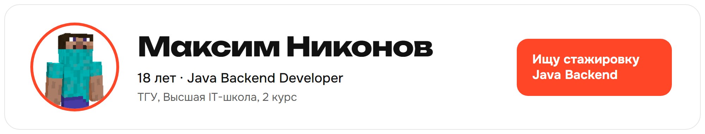
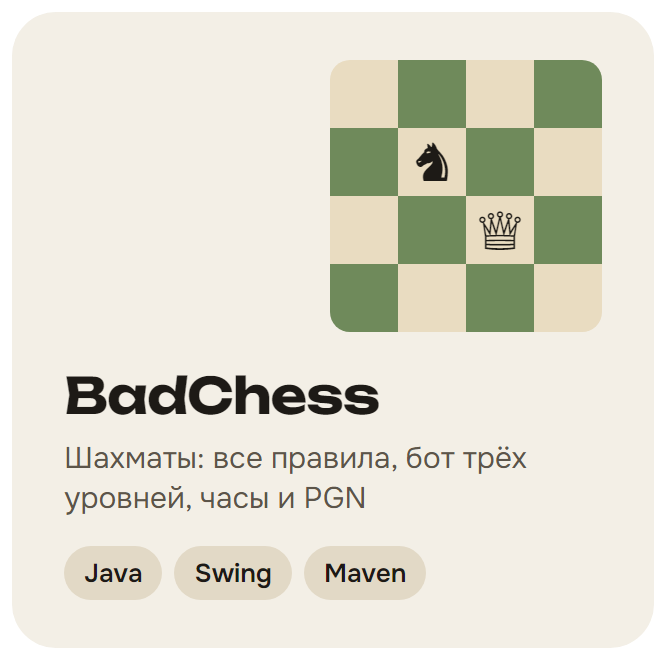
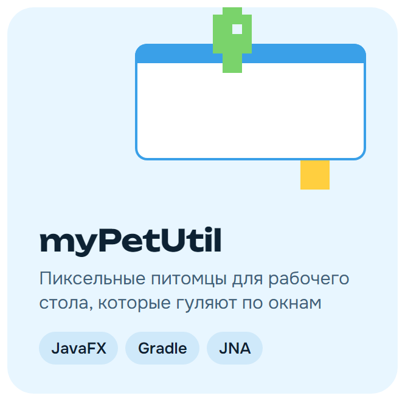
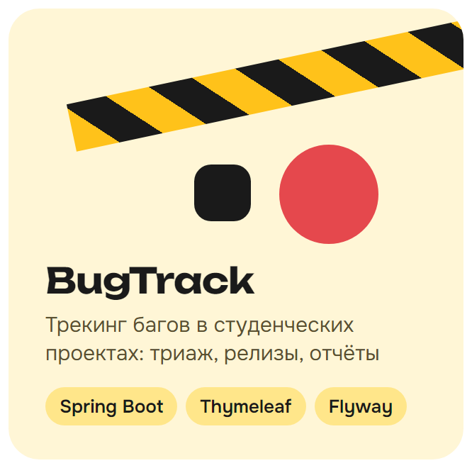
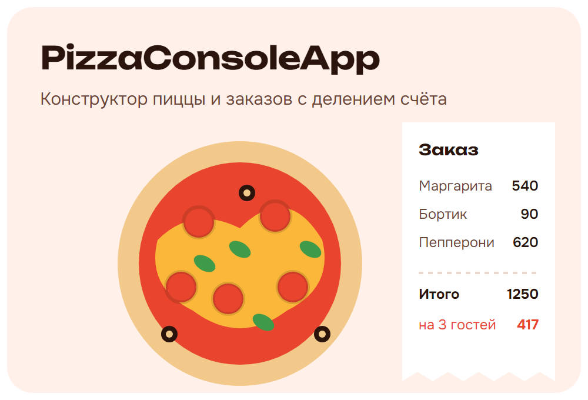
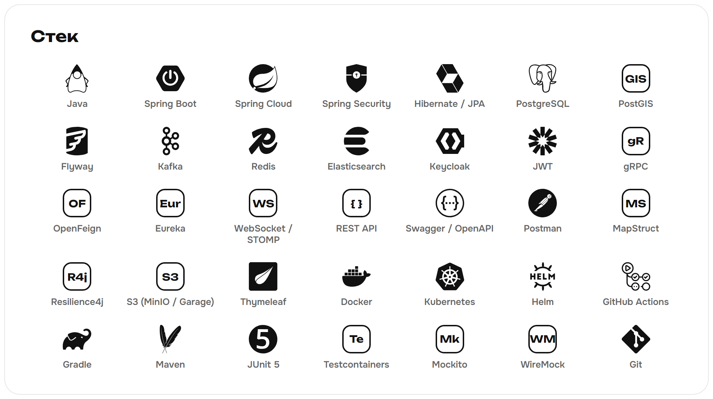

<picture><source media="(prefers-color-scheme: dark)" srcset="assets/header-dark.png"></picture>
<a href="https://github.com/nmaksimka/Delivery-Hub"><picture><source media="(prefers-color-scheme: dark)" srcset="assets/deliveryhub-dark.png"></picture></a>
<a href="https://github.com/nmaksimka/HB-system"><picture><source media="(prefers-color-scheme: dark)" srcset="assets/hb-system-dark.png"></picture></a><a href="https://github.com/nmaksimka/tasks-manager"><picture><source media="(prefers-color-scheme: dark)" srcset="assets/tasks-manager-dark.png"></picture></a><a href="https://github.com/nmaksimka/BadChess"><picture><source media="(prefers-color-scheme: dark)" srcset="assets/badchess-dark.png"></picture></a>
<a href="https://github.com/nmaksimka/myPetUtil"><picture><source media="(prefers-color-scheme: dark)" srcset="assets/mypetutil-dark.png"></picture></a><a href="https://github.com/nmaksimka/BugTrack"><picture><source media="(prefers-color-scheme: dark)" srcset="assets/bugtrack-dark.png"></picture></a><a href="https://github.com/nmaksimka/PizzaConsoleApp"><picture><source media="(prefers-color-scheme: dark)" srcset="assets/pizza-dark.png"></picture></a>
<a href="https://t.me/nknv_maks"><picture><source media="(prefers-color-scheme: dark)" srcset="assets/contact-telegram-dark.png"></picture></a><a href="mailto:maksimnikonov407@gmail.com"><picture><source media="(prefers-color-scheme: dark)" srcset="assets/contact-email-dark.png"></picture></a><a href="https://vk.com/gghrny"><picture><source media="(prefers-color-scheme: dark)" srcset="assets/contact-vk-dark.png"></picture></a><picture><source media="(prefers-color-scheme: dark)" srcset="assets/contact-location-dark.png"></picture>
<picture><source media="(prefers-color-scheme: dark)" srcset="assets/stack-dark.png"></picture>

## Кейсы

<b>DeliveryHub</b> — доставка еды на микросервисах

**Задача.** Хотел собрать сервис доставки так, как его строят в продакшене: заказ проходит через ресторан, оплату и курьера, и ни один сбой не должен оставить его в подвешенном состоянии.

**Решение.** Разбил систему на 10 сервисов на Spring Boot 4 и Java 25. Сервисы общаются через Kafka с Avro-схемами, заказ ведёт сага с компенсациями, события не теряются благодаря outbox и inbox. Авторизация на своих JWT с ротацией refresh-токенов, корзина в Redis, поиск в Elasticsearch, курьеры назначаются по геоданным PostGIS, трекинг заказа идёт по WebSocket. Заказ ходит в ресторан по gRPC.

**Итог.** Больше 1100 тестов, включая интеграционные на Testcontainers и контрактные. CI на GitHub Actions собирает образы, деплой в Kubernetes через Helm, метрики и логи в Grafana. [Репозиторий →](https://github.com/nmaksimka/Delivery-Hub)

<b>HB-system</b> — сервис дней рождения

**Задача.** Не забывать про дни рождения друзей и собирать подарок вместе так, чтобы именинник ничего не узнал заранее.

**Решение.** Сделали на хакатоне вдвоём, потом я доработал проект: сбор денег через Kafka с outbox и идемпотентными платежами, вход через Keycloak, бронь подарка с оптимистичной блокировкой, секретный чат на WebSocket, закрытый для именинника и на REST, и на подписке STOMP.

**Итог.** 7 сервисов за gateway, напоминания за 30, 7 и 1 день, новый интерфейс и больше сотни unit-тестов. [Репозиторий →](https://github.com/nmaksimka/HB-system)

<b>tasks-manager</b> — менеджер личных задач

**Задача.** Простое приложение для задач, где каждый видит только свои и может работать и через сайт, и через API.

**Решение.** Spring MVC с Thymeleaf и REST API поверх одного сервисного слоя, Spring Security с «запомнить меня», PostgreSQL и миграции Flyway. Сделал фильтры, поиск, сортировки, светлую и тёмную тему и горячие клавиши.

**Итог.** 63 теста, в том числе интеграционные на Testcontainers с настоящим PostgreSQL. [Репозиторий →](https://github.com/nmaksimka/tasks-manager)

<b>BadChess</b> — шахматы на Swing

**Задача.** В первой версии короля можно было просто съесть. Захотелось довести до настоящих шахмат.

**Решение.** Переписал движок со всеми правилами: рокировка, взятие на проходе, превращение, пат и ничьи. Проверил генерацию ходов perft-тестами. Добавил бота на минимаксе трёх уровней, шахматные часы, историю ходов, сохранение в PGN и темы доски.

**Итог.** Играбельные шахматы в одном jar и 52 теста на движок и бота. [Репозиторий →](https://github.com/nmaksimka/BadChess)

<b>myPetUtil</b> — питомцы для рабочего стола

**Задача.** Сделать для себя и друзей пиксельных питомцев, которые живут на рабочем столе и не мешают работать.

**Решение.** JavaFX с прозрачными окнами, через JNA читаю окна Windows: питомцы ходят по низу экрана или по верхним краям окон, учитывают несколько мониторов и полноэкранные программы. Шесть персонажей, бросок с гравитацией, кормление перетаскиванием, трей и темы настроек. Сборка в exe через jpackage.

**Итог.** В версии 1.0.1 после профилирования CPU упал с 17 до 14% ядра, память со 230 до 155 МБ, размер сборки со 163 до 59 МБ. [Репозиторий →](https://github.com/nmaksimka/myPetUtil)

<b>BugTrack</b> — трекинг багов

**Задача.** Реализовать систему по своим UML-диаграммам: проекты и команды, баги, триаж, исправление и проверка, релизы, отчёты.

**Решение.** Spring Boot 3.5 с Thymeleaf и Spring Security, PostgreSQL и Flyway, почта через SMTP, локально всё поднимается из Docker Compose. Каждое отступление от диаграмм записываю в отдельный документ, чтобы код и модель не расходились молча.

**Итог.** Сущности и схема по диаграммам, вход и регистрация, роли в проекте, демо-данные и тесты на Testcontainers. [Репозиторий →](https://github.com/nmaksimka/BugTrack)

<b>PizzaConsoleApp</b> — консольный конструктор пиццы

**Задача.** Лабораторная: каталог ингредиентов, основ и бортиков, сборка пицц и заказ на компанию, где стоимость делится между гостями.

**Решение.** Перевёл проект на Maven с wrapper, исправил найденные ошибки в расчётах и ограничениях бортиков, разделил модель и консольный интерфейс.

**Итог.** Запускается одной командой, 39 тестов, README с описанием возможностей. [Репозиторий →](https://github.com/nmaksimka/PizzaConsoleApp)

